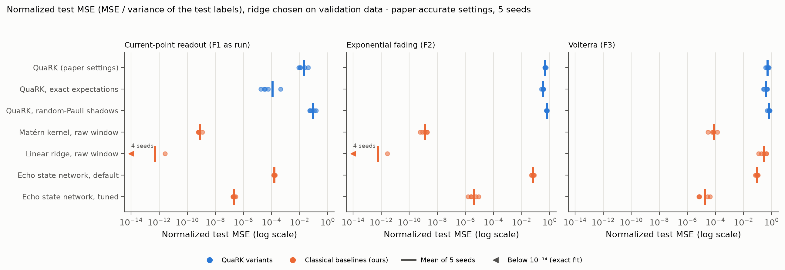
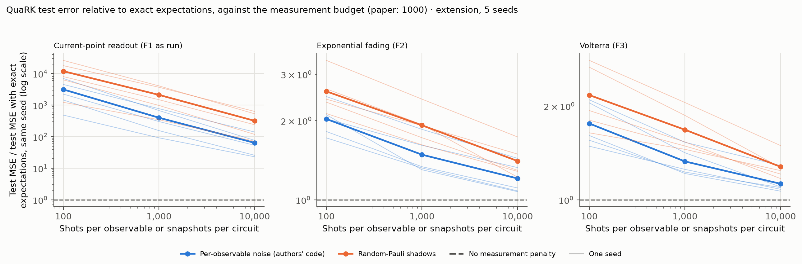

# QuaRK: A Quantum Reservoir Kernel for Time Series Learning - Reproduction

Status: the paper's experiments are reproduced, exactly at the authors' seed and then over 5 seeds, with four classical baselines and three extensions. Photonic adaptation: implemented in MerLin and run on the same 5 seeds (simulation); it matches QuaRK (message 5).

## Reference and Attribution

- Paper: "QuaRK: A Quantum Reservoir Kernel for Time Series Learning" (arXiv preprint, 2026)
- Authors: Abdallah Aaraba, Soumaya Cherkaoui, Ola Ahmad, Shengrui Wang
- arXiv: [2602.13531](https://arxiv.org/abs/2602.13531) (v1, 14 Feb 2026; cs.LG, quant-ph)
- Original repository: https://github.com/abdo-aary/quark (linked in Sec. 4 of the paper; MIT licence). The code version used as reference is commit `8f02ff1` (19 Feb 2026): its results notebook draws the paper's figures from the run the authors released.
- License and attribution notes: cite the paper above when reusing this reproduction.

## Original Paper

QuaRK learns a scalar label from a window of a multivariate time series. Each input point is projected to n numbers, encoded as qubit rotations and fed to a small quantum reservoir whose state is partly reset at every step, so it forgets old inputs. The features are the expectation values of all 1- and 2-qubit Pauli observables of the final state, estimated from measurements. A kernel ridge regression with a Matérn kernel reads them out. The paper uses n = 5 qubits per sub-reservoir, R = 3 sub-reservoirs (315 features) and 1000 measurement shots.

The data are synthetic: windows of 25 steps of a 3-dimensional VARMA(3,3) process passed through tanh. Three labels are learned:
- **F1**, called a one-step forecast in the text; in the authors' code it is a fixed linear readout of the last point of the window, which we call the **current-point readout**;
- **F2, exponential fading**: an exponentially weighted sum of the window;
- **F3, Volterra**: an exponentially weighted sum plus a quadratic term.

The paper's own takeaways (Sec. 4, paraphrased):
- past a clear transition, relaxing the readout regularization λ_reg drives the training error to numerical zero (Figs. 2 and 3);
- the test error decreases as the number of training windows N grows, and the three curves decay like 1/√N (Fig. 4);
- the ranking of the test errors, F1 < F2 < F3, mirrors how hard the three labels are to learn.

It also proves a generalization bound for windows drawn from a weakly dependent (β-mixing) process (Theorem 2). It reports no baseline, no seeds and no error bars.

## Reproduction Scope (including Updates and Deviations)

- **Reproduced:** the paper's three experiments (Figs. 2–4) on the authors' released dataset at their seed (12345), then on 5 seeds: 12345 and four new draws (1–4) made with the authors' procedure.
- **Added (ours):**
  - four classical baselines, run on the same windows and split: the same Matérn kernel ridge on the raw window, a linear ridge on the raw window, and an echo state network (315 units, like QuaRK's 315 features), untuned and tuned on 18 settings;
  - QuaRK with exact expectations (no shot noise) and with random-Pauli classical shadows;
  - shot budgets of 100, 1000 and 10000; n ∈ {3, 5, 7} at R = 3, and R ∈ {1, 3, 6} at n = 5;
  - the one-step forecast that the text describes for F1;
  - a numerical evaluation of the terms of Theorem 2.
- **Paper text and authors' code disagree** on several points. The released arrays behind the figures come from the code, so we follow it, and we run the text's version as a variant:

| Topic | Paper text | Authors' code (followed) |
|---|---|---|
| F1 label | u · X(t+1), a one-step forecast | u · X(t), the last point of the window |
| Shot noise | 1000 random-Pauli snapshots shared by all observables | independent noise on each of the 105 observables, 1000 shots each |
| Ridge term | K + N·λ_reg·I | K + λ_reg·I |
| λ_reg in Fig. 4 | one fixed, weak regularization | the value with the lowest test MSE (chosen on the test set) |
| Window spacing | stride 100 | stride 125 (gap 100) |
| Kernel smoothness | ν > 1 (Theorem 2) | ν chosen in {0.5, 1.5, 2.5, 5} |

- **Our protocol:** every comparison chooses λ_reg on validation data (20 % of the training windows). The test-set choice of the authors is reported next to it; it changes QuaRK's test MSE by 1.7 % at most.
- **Simulation:** the authors simulate an 11-qubit circuit with Qiskit Aer on GPUs. We evolve the 5-qubit density matrix in numpy and apply the partial reset in closed form. The two are mathematically identical; a unit test checks the circuit against the closed form.
- **Photonic adaptation (ours), a full MerLin implementation:** we rebuilt the reservoir with photons, 3 photons in 14 modes per sub-reservoir, simulated in MerLin. It keeps what QuaRK's results rest on: fixed random dynamics driven step by step, the partial reset (reproduced exactly), 1- and 2-local features from one shared shot budget, and the same readout, data, split and seeds. Threshold detectors give the features: how often each mode and each pair of modes click, 105 per sub-reservoir as in QuaRK, with no postselection. A control makes the photons distinguishable, so they cannot interfere. We assume ideal components: perfect photon sources, no loss, ideal detectors. The mapping, the alternatives we set aside and our confidence: [docs/photonic_adaptation.md](docs/photonic_adaptation.md).

## Install and How to Run

```bash
pip install -r papers/QuaRK/requirements.txt

# Smoke run (300 windows, two tasks, about 15 s): checks the pipeline, not evidence
python implementation.py --paper QuaRK --config configs/smoke_reduced.json

# QuaRK at the paper's settings (10,000 windows); seed 12345 is the authors' seed
python implementation.py --paper QuaRK --config configs/quark_original.json --seed 12345

# Photonic adaptation (MerLin, 1000 shots, about 11 min)
python implementation.py --paper QuaRK --config configs/quark_merlin.json --seed 12345

# From inside papers/QuaRK (there is no paper-local implementation.py)
python ../../implementation.py --config configs/quark_original.json
```

The four sweeps behind the results run one after the other: about 5.6 h, 3.8 h, 3.8 h and 4.5 h (photonic) on one 10-core CPU. `--validator` takes the `validate_logging.py` checker of the ALPS experiment-logging tooling; a run counts only if it passes.

```bash
for sweep in main_comparison shot_noise_ablation scaling photonic_adaptation; do
  python papers/QuaRK/utils/run_sweep.py papers/QuaRK/utils/sweep_specs/$sweep.json \
    --sweep-dir papers/QuaRK/outdir/sweep_$sweep --validator <path to validate_logging.py>
done
```

Statistics, comparisons with the authors' run and with the photonic version, and figures:

```bash
python papers/QuaRK/utils/forecast_noise_floor.py papers/QuaRK/outdir/sweep_main_comparison --candidate quark
python papers/QuaRK/utils/report_statistics.py --main papers/QuaRK/outdir/sweep_main_comparison \
  --shot-noise papers/QuaRK/outdir/sweep_shot_noise_ablation --scaling papers/QuaRK/outdir/sweep_scaling \
  --noise-floor papers/QuaRK/results/forecast_noise_floor.json
python papers/QuaRK/utils/compare_with_release.py papers/QuaRK/outdir/run_<timestamp> \
  --release-run data/QuaRK/authors_release_v1.0.0/storage/results/reg_sweep/c-shadows/full/N=10000__w=25__d=3__s=100/2026-02-02_14-02-13
python papers/QuaRK/utils/compare_photonic_with_quark.py --photonic papers/QuaRK/outdir/sweep_photonic_adaptation \
  --main papers/QuaRK/outdir/sweep_main_comparison --shot-noise papers/QuaRK/outdir/sweep_shot_noise_ablation
```

The `plot_*.py` scripts in `utils/` draw the figures; each one's docstring gives its command.

Each run writes `outdir/run_YYYYMMDD-HHMMSS/` with `run.log`, `run_status.json`, `config_snapshot.json`, `metrics.json`, `regularization_sweep.npz`, `training_size_sweep.npz` and `fit_examples.npz` (and `features.npz` for `quark_original`).

## Configuration

One config per model; all of them overlay `configs/defaults.json`:

| Config | Model |
|---|---|
| `defaults.json` | QuaRK at the paper's settings on 600 windows (lightweight default) |
| `smoke_reduced.json` | Smoke run: 300 windows, two tasks, short tuning search |
| `quark_original.json` | QuaRK as in the paper and the authors' code: n = 5 qubits, R = 3 sub-reservoirs, all 1- and 2-local Paulis, per-observable shot noise with 1000 shots |
| `quark_exact_original.json` | QuaRK with exact (noise-free) expectations |
| `quark_shadows_original.json` | QuaRK with classical shadows as the paper text describes them (1000 shared random-Pauli snapshots) |
| `raw_window_kernel_classical.json` | Same Matérn kernel ridge readout on the raw window |
| `raw_window_linear_classical.json` | Linear ridge on the raw window |
| `esn_default_classical.json` | Untuned echo state network (315 units) with the Matérn readout |
| `esn_tuned_classical.json` | Echo state network tuned on validation (18 configurations) with the Matérn readout |
| `quark_merlin.json` | Photonic adaptation in MerLin: 3 photons in 14 modes per sub-reservoir, R = 3, threshold detectors, 1000 shots shared by all features |
| `quark_exact_merlin.json` | Photonic adaptation with exact (noise-free) click probabilities |
| `quark_distinguishable_merlin.json` | Photonic adaptation, exact, with distinguishable photons: the control without interference |

The sweeps are defined in `utils/sweep_specs/`. Paper-specific flags (`cli.json` is the authoritative list): `--num-windows`, `--estimator`, `--shots`, `--num-qubits`, `--num-reservoirs`, `--merlin-shots` (shots of the photonic adaptation). Shared flags include `--seed`, `--outdir` and `--data-root`.

## Data

The paper uses synthetic data only: windows of a VARMA(3,3) process passed through tanh, labelled by three functionals (paper Sec. 4.1 and App. B). The authors publish the exact dataset and the arrays behind Figs. 2–4 as `storage.zip` in release v1.0.0 of their repository. This reproduction uses that file (about 24 MB):

```bash
# From the repository root
mkdir -p data/QuaRK/authors_release_v1.0.0
curl -L -o data/QuaRK/authors_release_v1.0.0/storage.zip \
  https://github.com/abdo-aary/quark/releases/download/v1.0.0/storage.zip
echo "ca1adc9c1a4f359f68e3bc45735552f1358baff086e859b7854c1d43eaca5567  data/QuaRK/authors_release_v1.0.0/storage.zip" | shasum -a 256 -c
unzip -q -o data/QuaRK/authors_release_v1.0.0/storage.zip -d data/QuaRK/authors_release_v1.0.0
```

The data root is `data/` at the repository root, or `$DATA_DIR` when that variable is set. The files used are under `data/QuaRK/authors_release_v1.0.0/storage/`:

| Path | Content |
|---|---|
| `data/synthetic/varma/N=10000__w=25__d=3__s=100/varma__e2_three__N=10000__w=25__d=3__s=100__seed=12345.npz` | `X`: 10,000 windows of 25 steps in 3 dimensions; `y`: the labels of the three tasks (3 × 10,000) |
| `results/reg_sweep/c-shadows/full/N=10000__w=25__d=3__s=100/2026-02-02_14-02-13/` | The authors' run behind Figs. 2–4: features, train/test split, selected kernels, regularization sweep, training-size sweep |

Limitations:
- The release holds one draw of the data (seed 12345). Extra seeds must be generated with the authors' procedure; they are not the authors' files.
- `artifacts/train_size_sweep.pkl` is a Python pickle. Load it only with an unpickler restricted to numpy arrays.
- The release has no licence of its own; the repository is MIT-licensed.

## Results Obtained and Comparison with the Paper

Five messages:
1. [Our run at the authors' seed matches their published run](#1-our-run-at-the-authors-seed-matches-their-published-run)
2. [Every classical baseline has a lower test error than QuaRK](#2-every-classical-baseline-has-a-lower-test-error-than-quark)
3. [Shot noise inflates QuaRK's error, and the paper's figures use the milder noise model](#3-shot-noise-inflates-quarks-error-and-the-papers-figures-use-the-milder-noise-model)
4. [The paper's learning claims hold only in part](#4-the-papers-learning-claims-hold-only-in-part)
5. [A photonic version of the reservoir matches QuaRK, with or without photon interference](#5-a-photonic-version-of-the-reservoir-matches-quark-with-or-without-photon-interference)

Metric: the test MSE on 2,000 held-out windows. The normalized test MSE divides it by the variance of the test labels, so tasks can be compared. Unless stated otherwise, λ_reg is chosen on validation data, values are means over the 5 seeds, and two models are compared seed by seed with a rule fixed before the runs (difference beyond twice its standard error). Every table behind these messages, including the reservoir-size sweep: [`results/statistics.md`](results/statistics.md), and for the photonic version [`results/photonic_comparison.md`](results/photonic_comparison.md).

### 1. Our run at the authors' seed matches their published run

The authors publish the arrays behind their figures. On their dataset and seed, our values against theirs:

| Quantity | Authors' release | This reproduction |
|---|---|---|
| Kernel chosen per task (ν, ξ): F1 / F2 / F3 | (5, 17.496) / (0.5, 17.016) / (0.5, 15.392) | same (ξ within 10⁻⁹) |
| Fig. 2, training MSE at λ_reg = 10⁵: F1 / F2 / F3 | 0.4736 / 0.9378 / 1.2690 | same |
| Fig. 4, test MSE from N = 100 to 8000, F1 | 0.0888 → 0.00431 | same |
| Fig. 4, same, F2 | 0.715 → 0.449 | same |
| Fig. 4, same, F3 | 0.936 → 0.651 | same |
| Fig. 4, λ_reg used: F1 / F2 / F3 | 10⁻¹² / 0.005 / 10⁻¹² | same |

**Result:** the features are identical, and every value of Figs. 2 and 4 agrees with the release within a relative difference of 1.5·10⁻⁹. The training MSE values below 10⁻¹⁰ are rounding noise; they agree within 10⁻²⁰.

Figures: [Fig. 2](results/fig2_regularization_sweep.png), [Fig. 3](results/fig3_fit_examples.png), [Fig. 4](results/fig4_training_size_sweep.png); crosses mark the release's values. These are single-seed figures (preliminary by our labelling rule); messages 2 to 4 use the 5 seeds.

### 2. Every classical baseline has a lower test error than QuaRK



**Look at:** each row is a model and each dot a seed; the bar is the mean. The axis is logarithmic. QuaRK's rows (blue) lie to the right, at higher error, of every classical row (orange) in the three panels. Values below 10⁻¹⁴ are drawn at the left edge: the linear ridge represents F1 and F2 exactly, because both are linear in the window.

**Result:** each classical baseline has a lower test MSE than QuaRK on each of the three tasks, in 5 of 5 seeds. The untuned echo state network, a random fixed reservoir like QuaRK's, reaches a normalized test MSE of 0.063 (F2) and 0.090 (F3), against QuaRK's 0.48 and 0.51. Even without shot noise, QuaRK stays behind every baseline on F2 and F3 (5 of 5 seeds; this comparison was added after the runs).

The paper reports no baseline; these four models are ours.

### 3. Shot noise inflates QuaRK's error, and the paper's figures use the milder noise model



**Look at:** each seed's test MSE is divided by the same seed's test MSE with exact expectations; the dashed line (1) means no penalty from measurement. Blue is the authors' noise model, orange the random-Pauli shadows that the paper's text describes. The 1000-shot point is the paper's setting.

**Result:** at 1000 shots, measurement multiplies QuaRK's test MSE by 1.48 (F2) and 1.33 (F3) with the authors' model, and by 1.92 and 1.68 with random-Pauli shadows. On F1, which the exact features fit almost perfectly, the factors are about 400 and 2,100. On the three tasks, the penalty falls at every tenfold increase of the budget, in 5 of 5 seeds.

The two models differ because the authors' code draws independent noise for each of the 105 observables, as if each had its own 1000 shots, while the text describes 1000 snapshots shared by all observables.

### 4. The paper's learning claims hold only in part

| Paper's claim | What we find (5 seeds) | Verdict |
|---|---|---|
| Relaxing λ_reg drives the training MSE to numerical zero (Fig. 2) | Reproduced: at most 6·10⁻²¹ at λ_reg = 10⁻¹². Every Matérn-kernel model does the same, classical ones included (at most 10⁻¹²) | Supported; not specific to the quantum reservoir |
| The test MSE decreases as N grows (Fig. 4) | It falls at every step from N = 100 to 8000, in every seed, on the three tasks | Supported |
| … with "the same 1/√N shape" | Slope of log test MSE against log N, from N = 500 to 8000: −0.46 on F1 (95 % interval −0.55 to −0.37), −0.09 on F2 and on F3 ([figure](results/training_size_seeds.png)); 1/√N is a slope of −0.5 | Holds for F1 only |
| The ranking F1 < F2 < F3 mirrors how hard the labels are | The ranking holds in 5 of 5 seeds, but for every model, including the linear ridge that solves F1 and F2 exactly. With F1 as the text defines it, a one-step forecast, it holds for QuaRK in 3 of 5 seeds, and in none after normalization | Partially supported |
| Generalization bound (Theorem 2) | At N = 8000 the bound is at least 1,400 times the measured gap between test and training MSE, even with choices that favour it. The authors' tuning picks ν = 0.5 for F2 and F3, outside the theorem's ν > 1 | Far from the measured errors; not checked as mathematics |

**Result:** the test error does fall with N, but only one of the three curves has the 1/√N shape, the task ranking follows from how linear each label is, and the bound is more than a thousand times looser than the measured gap.

### 5. A photonic version of the reservoir matches QuaRK, with or without photon interference

The photonic version (see the Reproduction Scope) ran the same experiments on the same windows, split and seeds. Normalized test MSE, mean over the 5 seeds:

| Task | QuaRK, exact | Photonic, exact | Photonic, distinguishable photons | QuaRK, 1000 shots (shadows) | Photonic, 1000 shots |
|---|---:|---:|---:|---:|---:|
| F1, current-point readout | 1.2·10⁻⁴ | 1.4·10⁻⁴ | 1.4·10⁻⁴ | 0.088 | 0.057 |
| F2, exponential fading | 0.328 | 0.307 | 0.307 | 0.620 | 0.492 |
| F3, Volterra | 0.391 | 0.388 | 0.387 | 0.634 | 0.589 |

**Result:** with exact features, the photonic reservoir and QuaRK are not separated on any task, and distinguishable photons, which cannot interfere, give the same test MSE (the means differ by at most 0.0011 on the three tasks; the spread between seeds is 0.06 on F2 and F3).

In every photonic run, the paper's first two claims hold on the three tasks: the training MSE falls below 10⁻¹⁶ at λ_reg = 10⁻¹², and the test MSE is lower at N = 8000 than at N = 100. With 1000 shots shared by all features, the photonic version has a lower test MSE than QuaRK with random-Pauli shadows on F1 and F2 (4 and 5 of 5 seeds; not separated on F3); QuaRK with the authors' milder noise model stays lower on F1 and F3. Like QuaRK, it stays behind the kernel on the raw window and both echo state networks on F2 and F3, in 5 of 5 seeds.

Our reading: at 3 photons in 14 modes, the accuracy comes from the nonlinear encoding and the fading memory, not from quantum interference. The paper has no photonic version; this one is ours.

## Limitations

- The data are synthetic, as in the paper. With 3 input dimensions and 5 qubits, the projection never reduces the dimension, so the paper's point about high-dimensional inputs is not tested.
- Seeds 1–4 are new draws of the authors' process, not files from their release.
- We evaluated the terms of Theorem 2 but did not re-check its proof. The evaluation takes the norm of the fitted readout as the ball radius and drops the dependence correction, which can only lower the bound.
- The random-Pauli shadow estimator is our implementation of the paper's text; the authors' code has none.
- The 5-qubit reservoir is classically simulable by construction; no claim about quantum cost or speed is tested.
- The tuned echo state network searches 18 reservoir settings while QuaRK's reservoir is untuned; the untuned network is reported for that reason.
- The photonic version is simulated with ideal components, and 3 photons in 14 modes is classically simulable. On hardware, reproducing the reset exactly means reprogramming the circuit at every shot to run a random number of the last steps, up to 25. The no-interference control uses fully distinguishable photons; partial distinguishability was not run.

## Tests

```bash
cd papers/QuaRK
pytest -q
```

32 tests: the circuit against the closed-form reset, contraction, the Matérn kernel against scikit-learn, interpolation, the Pauli observables and shadows, the bound formula, the match with the authors' release (data, split, features), the runner, the CLI flags and every config. For the photonic version: MerLin's probabilities against permanents computed from the same circuit (with and without interference), threshold detection without postselection, the reset reproduced as a mixture of shorter circuits, and the features and their seeding.

## Citation and License

Cite arXiv:2602.13531. Code in this folder follows the repository license.
