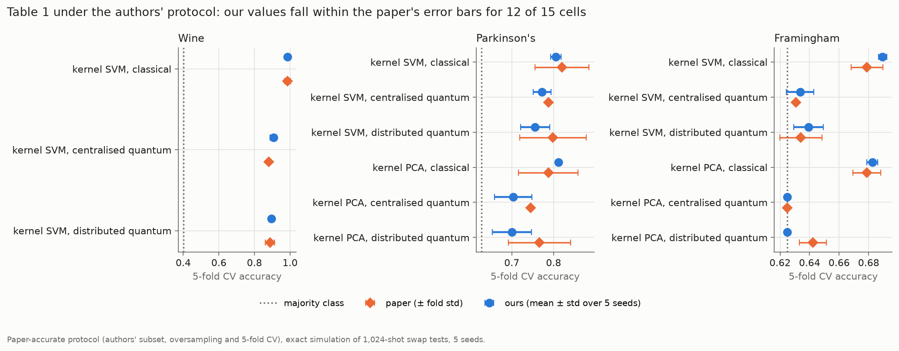
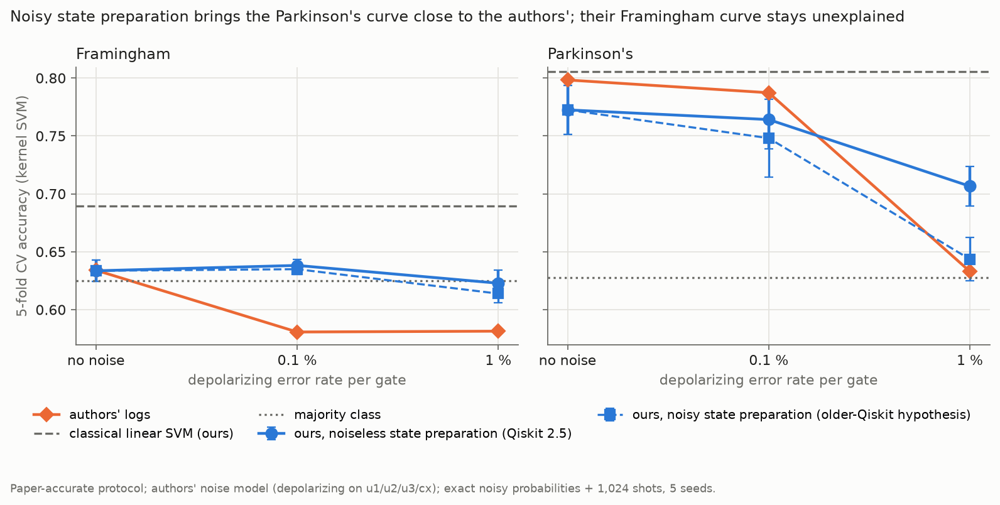
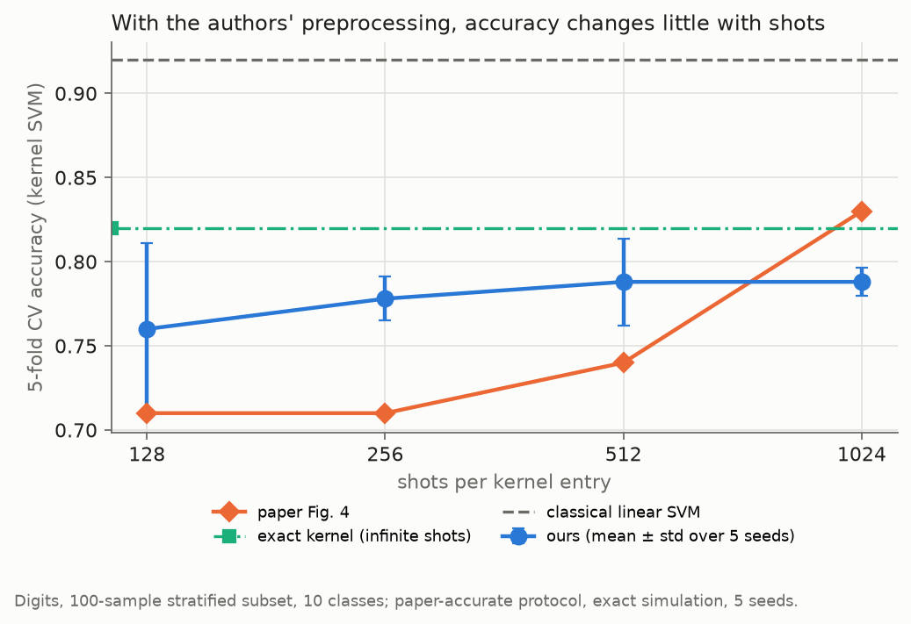
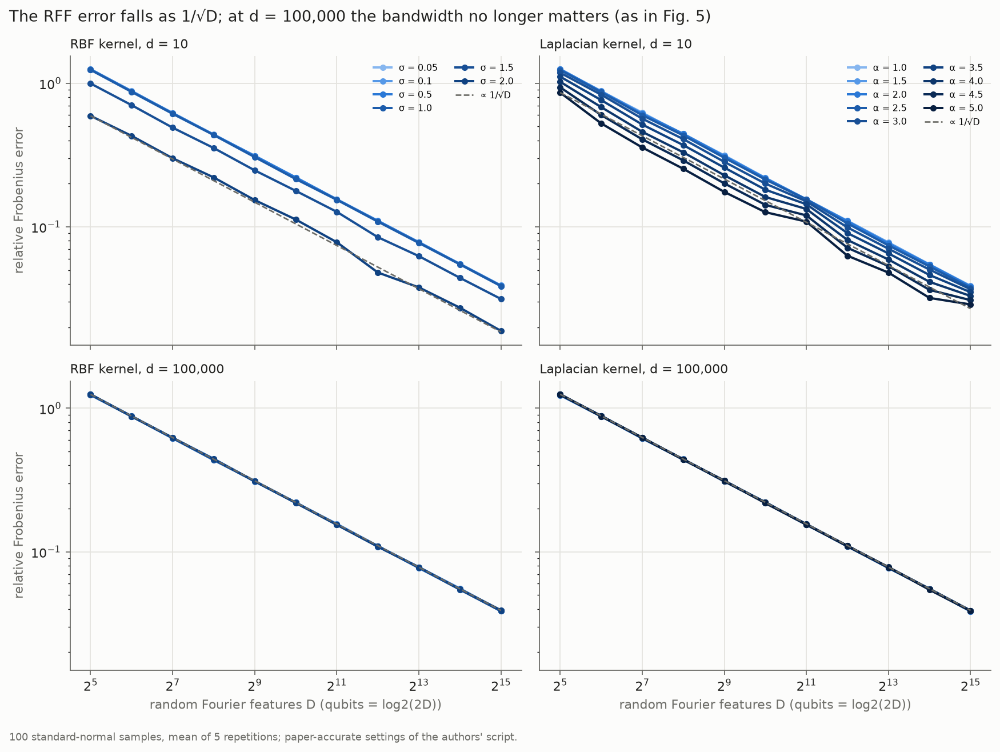
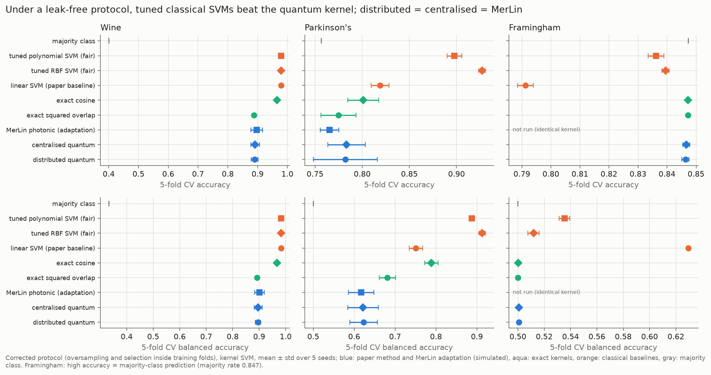

# Distributed and Secure Kernel-Based Quantum Machine Learning - Reproduction

Status: all paper experiments run (5 seeds each, exact simulation of the swap-test circuits), a partial photonic (MerLin) adaptation evaluated, and a fair classical comparison made; results below.

## Reference and Attribution

- Paper: "Distributed and Secure Kernel-Based Quantum Machine Learning", Transactions on Machine Learning Research (2025)
- Authors: Arjhun Swaminathan, Mete Akgün
- OpenReview: https://openreview.net/forum?id=3jdI0aEW3k
- arXiv: https://arxiv.org/abs/2408.10265 (v3, the version read for this reproduction)
- Original repository: https://github.com/mdppml/distributed-secure-kernel-based-QML (commit `aed2cf9` used here), archived on Zenodo as v1.0: https://doi.org/10.5281/zenodo.18743937
- License and attribution notes: the authors' repository is MIT-licensed. This reproduction re-implements their pipeline; it does not copy their code.

## Original Paper

Two data holders want a kernel between their private samples without revealing them. Each amplitude-encodes its data; a helper distributes Bell pairs; the states are teleported to a server, which estimates the kernel with a swap test. The paper evaluates kernel SVM and kernel PCA on public tabular datasets and studies shot noise and depolarizing noise. The architecture gives an explicit n-qubit construction of the distributed swap-test protocol of Sheng & Zhou (2017)[^sheng-zhou], and our checks confirm it on entangled multi-qubit states.

[^sheng-zhou]: Sheng & Zhou (2017, Science Bulletin 62, 1025) is paywalled; we could not read its full text and rely on its abstract and on the paper's Sec. 3.2.

## Reproduction Scope, Claims, and Deviations

Claims tested (the paper's own wording is "comparable", not "better"):

- the distributed protocol computes the same kernel as a centralised swap test (App. A);
- distributed quantum accuracy is comparable to centralised quantum and classical accuracy, and centralised classical methods are generally highest (Table 1);
- depolarizing noise lowers accuracy (Fig. 3), and more shots raise it (Fig. 4);
- the proposed feature maps give the polynomial, RBF and Laplacian kernels (Theorems 1–6), with random-Fourier-feature error decreasing as 1/√D (Fig. 5);
- the protocol is secure against semi-honest parties (Sec. 6.3). This is an argument, so only the clients' messages are checked.

Reproduced, on the original data files, with seeds 0–4 and the paper's stratified 5-fold CV:

- Table 1 (kernel SVM and kernel PCA; centralised classical, centralised quantum and distributed quantum columns; 1,024 shots);
- Fig. 3 (0.1 % and 1 % depolarizing noise, the authors' noise model);
- Fig. 4 (128–1,024 shots on the 100-sample Digits subset);
- Fig. 5 (random-Fourier-feature error vs D, d = 10 and d = 100,000);
- numerical checks of Theorems 1–6 (proposed feature maps) and of the protocol (App. A), against per-shot Qiskit Aer runs.

Updates and deviations:

- **Simulation setup.** The authors simulate every kernel entry shot by shot with Qiskit Aer on an HPC cluster. Done locally this costs 8–13 s per entry (Wine alone: 23–38 h per seed). We compute instead the exact probability that the swap test reads 0, p₀ = ½ + ½|⟨a|b⟩|², and draw the 1,024 shots from Binomial(1,024, p₀). Without noise, teleportation is exact, so this gives the same distribution as the shot-by-shot simulation, not an approximation. With noise, p₀ comes from the noise channel of the transpiled circuit. Checks:
  - shot-by-shot Aer runs of the authors' circuit follow the same law (χ² test, 30 random state pairs);
  - with noise, |Δp₀| ≤ 0.004;
  - our noiseless kernel values match the distribution of the authors' logged values.

  All runs used a 10-core laptop CPU (Python 3.14, Qiskit 2.5.2, Aer 0.17.2), with seeds 0–4; each gate-model sweep takes at most about 11 minutes.
- **Circuits.** The authors' 4n + 1-qubit circuit is ported to Qiskit 2.x (`if_test` replaces `c_if`), including their extra Hadamard before each teleportation. Their released code does not run as published.
- **What the kernel is.** The authors' code uses 2 Pr(0) − 1, the *squared* overlap, i.e. the squared cosine similarity of the standardised features. The paper calls it the linear kernel; its Eq. 11 takes the square root, which gives the cosine without its sign. The exact cosine kernel is reported as an additional reference.
- **Protocols.** `paper` follows the authors' pipeline: oversampling before the split and before CV, the scaler fitted on the evaluated subset, kernel PCA fitted on all samples, and the component count chosen as the best of 2–7 on the CV folds. `corrected` oversamples inside training folds only and chooses C and the component count by inner CV. For Framingham the C grid stops at 10, for runtime. Code of `paper`: `lib/data.py::build_dataset` (oversampling of the whole dataset, scaler on the subset), `lib/evaluation.py::paper_kernel_svm` and `paper_kernel_pca`; folds from `lib/evaluation.py::stratified_folds`. Code of `corrected`: `lib/evaluation.py::corrected_cv` (scaler and `oversample_indices` per training fold, inner CV for C) and `_corrected_kernel_pca_fold`.
- **Additional baselines.** These are not in the paper: the exact infinite-shot kernel, the exact cosine kernel, a majority-class predictor, and tuned RBF and polynomial SVMs (corrected protocol).
- **Oversampling.** `RandomOverSampler(0.6)` is re-implemented. The authors' run was unseeded; we use seeds 0–4.
- **Photonic adaptation.** The server's swap test is also run as a MerLin photonic circuit (see "Photonic Assessment and MerLin Extension"). This is an addition, not part of the paper.

## Project Layout

```text
distributed_secure_kernels/
|-- notebook.ipynb            walkthrough: claims, live checks and runs, fair comparison, MerLin
|-- cli.json, configs/        paper-specific flags; one JSON config per experiment and variant
|-- lib/
|   |-- runner.py             train_and_evaluate(cfg, run_dir): experiment dispatch
|   |-- data.py, encoding.py  dataset loaders, oversampling, amplitude encoding
|   |-- kernels.py, noise.py  swap-test kernels, shot sampling, exact noisy probabilities
|   |-- protocol.py           the authors' circuits (Qiskit 2.x) and per-shot Aer runs
|   |-- evaluation.py         kernel SVM / kernel PCA under the paper and corrected protocols
|   |-- feature_maps.py, rff_error.py   Theorems 1–6 and Fig. 5
|   `-- photonic_merlin.py    MerLin photonic swap test (adaptation)
|-- utils/                    sweep coordinator, summaries, comparisons, figures
|-- tests/                    pytest suite
|-- docs/sweep_plans/         dated plans of the two re-run sweeps
`-- results/                  curated tables and figures used below
```

## Install and How to Run

```bash
python -m venv .venv
source .venv/bin/activate
pip install -r requirements.txt

# From the repository root
python implementation.py --paper distributed_secure_kernels --help

# Smoke run (Wine, paper protocol, seconds)
python implementation.py --paper distributed_secure_kernels --config configs/defaults.json

# One paper experiment for one seed
python implementation.py --paper distributed_secure_kernels --config configs/accuracy_parkinsons_original.json --seed 0

# A full 5-seed sweep (writes outdir/sweep_<id>_<stamp>/ with summary.json)
python papers/distributed_secure_kernels/utils/run_sweep.py --sweep-id table1_original --seeds 0 1 2 3 4 --workers 5 \
    --configs configs/accuracy_wine_original.json configs/accuracy_parkinsons_original.json configs/accuracy_framingham_original.json
```

Walkthrough: `notebook.ipynb` (run it from this folder) reruns the Wine, Parkinson's and Digits experiments live with five seeds, checks them against the stored sweeps, and loads the longer runs from `results/`. It takes about 2–3 minutes on a laptop CPU.

Each run writes `outdir/run_YYYYMMDD-HHMMSS/` with `run.log`, `run_status.json`, `config_snapshot.json` and `metrics.json`; each sweep writes `outdir/sweep_<id>_<stamp>/` with `sweep.log`, `sweep_status.json` and `summary.{json,md}`. Curated tables and figures are in `results/`. These scripts regenerate them from the sweep and run folders:

| Script | Output |
|---|---|
| `utils/compare_with_paper.py` | `results/paper_comparison.{json,md}` |
| `utils/plot_table1.py`, `utils/plot_noise.py`, `utils/plot_shots.py`, `utils/plot_rff_error.py` | the four paper-figure comparisons |
| `utils/diagnose_gaps.py` | `results/gap_diagnostics.json` |
| `utils/compare_merlin.py` | `results/merlin_comparison.{json,md}` |
| `utils/fair_comparison.py`, `utils/plot_fair_comparison.py` | `results/fair_comparison.{json,md,png}` |
| `utils/export_sweep_tables.py` | `results/sweep_results.{md,json}` (full table of every sweep; the JSON keeps the per-seed values the notebook reads) |
| `utils/merlin_noise_check.py` | MerLin distinguishability-noise check (printed; see "Photonic Assessment and MerLin Extension") |

## Configuration

`cli.json` is the authoritative list of paper-specific flags: `--protocol`, `--n-splits` and `--cv-random-state`, plus the sweep identity flags that `utils/run_sweep.py` sets. Configs:

| Config | Experiment |
|---|---|
| `accuracy_<dataset>_original.json` | Table 1, the paper's three columns, paper protocol |
| `accuracy_<dataset>_reference.json` | exact squared-overlap and cosine kernels, majority class, paper protocol |
| `accuracy_<dataset>_corrected.json`, `accuracy_<dataset>_classical.json` | corrected protocol; paper columns, and tuned RBF / polynomial SVMs on a first γ grid, 10× off the planned one (the fair comparison uses `accuracy_<dataset>_fair_classical.json`) |
| `noise_<dataset>_original.json` | Fig. 3 |
| `noise_<dataset>_decomposed_initialize.json` | diagnostic: noisy, decomposed state preparation |
| `shots_digits_original.json` | Fig. 4 |
| `rff_error_original.json`, `rff_error_high_dimension.json` | Fig. 5 (d = 10, d = 100,000); `rff_error_reduced.json` is a small version for the tests |
| `feature_map_identities_original.json` | Theorems 1–6 |
| `protocol_equivalence_original.json`, `protocol_equivalence_four_qubits.json` | App. A, per-shot Aer checks |
| `accuracy_<dataset>_merlin.json`, `shots_digits_merlin.json` | MerLin adaptation (photonic swap test), Table 1 and Fig. 4 settings |
| `accuracy_<dataset>_fair_classical.json`, `accuracy_<dataset>_merlin_corrected.json` | fair comparison: tuned RBF / polynomial SVMs (planned grids) and MerLin under the corrected protocol |

## Data

Datasets live under `data/distributed_secure_kernels/` (resolved by `runtime_lib.data_paths.paper_data_dir`), one folder per dataset with a `SHA256SUMS` file. They are not tracked in git.

| Dataset | Folder | Source | Licence |
|---|---|---|---|
| Wine (178 samples, 13 features, 3 classes) | `wine/` | scikit-learn 1.9.1 bundled file (`load_wine`) | UCI, shipped with scikit-learn |
| Digits (1,797 samples, 64 pixels, 10 classes) | `digits/` | scikit-learn 1.9.1 bundled file (`load_digits`) | UCI, shipped with scikit-learn |
| Parkinson's (195 recordings, 22 features) | `parkinsons/` | authors' repository, commit `aed2cf9`; UCI dataset 174 (Little 2007) | CC BY 4.0 |
| Framingham (4,238 patients, 15 features; 14 used) | `framingham/` | authors' repository, commit `aed2cf9`; Kaggle dataset by A. Bhardwaj (2022) | "Unknown" on Kaggle |

To recreate them, clone the authors' repository into `data/distributed_secure_kernels/sources/authors_repo` and copy the two data files and the two scikit-learn files into the folders above; check with `shasum -a 256 -c SHA256SUMS` in each folder.

Limitations:
- Parkinson's is the UCI file the authors' code reads; the paper cites a different Parkinson's dataset (Sakar et al. 2019).
- The Framingham file is the authors' copy. Its size differs from the file listed on Kaggle (195,955 vs 191,803 bytes); the contents were not compared because the Kaggle download needs a login.
- Fig. 5 uses synthetic standard-normal data generated at run time, as in the authors' script (the paper only says "simulated datasets").

## Results Obtained and Comparison with the Paper

Scope: paper-accurate protocol and settings, exact simulation of the 1,024-shot swap tests, 5 seeds. Sources of the paper values: Table 1 and Fig. 4 of the paper; Fig. 3 shows bars only, so its values come from the authors' released logs. Two Table 1 values (Wine, quantum columns) do not appear in any released log.

Summary per paper item. Accuracy values are stratified 5-fold CV accuracy; "metric agreement" counts the cells matched by the rule below; the MerLin row compares with our gate-model run, not with the paper.

| Paper item | Claim tested | Paper value | Reproduced value | Difference | Metric agreement | Trend agreement | Claim support | Seeds | Comment |
|---|---|---:|---:|---:|---|---|---|---:|---|
| Table 1 | distributed ≈ centralised; classical highest | distributed kernel SVM, Wine / Parkinson's / Framingham: 0.887 / 0.798 / 0.634 | 0.896 / 0.756 / 0.639 | +0.008 / −0.043 / +0.005 | 12 of 15 cells | yes: classical highest in 5 of 5 rows (by mean); distributed ≈ centralised | supported (both) | 5 | Framingham distributed kernel PCA equals the majority-class rate |
| Fig. 3 | noise lowers accuracy | kernel SVM at 0.1 % / 1 % (authors' logs): Framingham 0.581 / 0.581, Parkinson's 0.787 / 0.633 | 0.638 / 0.623, 0.764 / 0.707 | +0.058 / +0.041, −0.023 / +0.074 | 1 of 6 cells | partly: lower at 1 % on both; at 0.1 % within seed std of no noise | trend supported, magnitude not | 5 | Parkinson's matches with noisy state preparation (diagnostic); Framingham logs unexplained |
| Fig. 4 | more shots raise accuracy | 128 / 256 / 512 / 1,024 shots: 0.71 / 0.71 / 0.74 / 0.83 | 0.760 / 0.778 / 0.788 / 0.788 | +0.050 / +0.068 / +0.048 / −0.042 | 0 of 4 cells | weak: steps below the 128-shot seed std (0.051) | not clearly reproduced | 5 | values inside the spread from the unknown fold assignment |
| Fig. 5 | RFF error decreases as 1/√D | curves only | relative Frobenius error 0.593 / 0.113 / 0.019 at D = 32 / 1,024 / 32,768 (RBF, σ = 2, d = 10) | N/A | N/A (no printed values) | yes, and bandwidth-independent at d = 100,000 | supported | 5 repetitions | synthetic standard-normal data, as in the authors' script |
| Theorems 1–6 | feature maps give the stated kernels | identities (proofs) | polynomial: ‖ψ‖² from 0.43 to 1,246; RBF / Laplacian inner-product error 0.0018 / 0.0020 at D = 65,536 | N/A | N/A | N/A | polynomial unsupported; RBF / Laplacian supported as inner products | N/A (random draws) | with the authors' estimator (2 Pr(0) − 1), a swap test gives the square, i.e. the kernel at σ/√2 or α/2; the square root of Eq. 11 gives the kernel itself |
| App. A | distributed circuit = centralised swap test | proof | per-shot Aer vs the binomial law: pooled χ² p ≈ 0.14 (distributed), 0.26 (centralised); the paper's Fig. 2 built as drawn (6n + 1 qubits) follows the same law (`tests/test_protocol.py`) | N/A | N/A | N/A | supported | 30 random pairs | the authors' estimator 2 Pr(0) − 1 gives the squared overlap |
| Sec. 6.3 | secure against semi-honest parties | argument | client bits uniform: largest deviation from ½ 0.037 (standard error 0.016) | N/A | N/A | N/A | not testable beyond this check | N/A | the server receives 1,024 copies of each encoded state per kernel entry |
| MerLin adaptation | photonic swap test preserves the results | our gate-model distributed kernel, 9 settings | same within 2 σ in 8 of 9 settings | largest +0.032 (Digits, 1,024 shots; tolerance 0.029) | 8 of 9 settings | yes | preserved (simulation) | 5 | 4 photons, 12–24 modes, ideal photon-number-resolving detectors; see "Hardware-Aware Settings" |

Every sweep behind these numbers is complete (7 sweeps, 130 of 130 planned runs) and repeats fixed configurations over seeds, so no candidate is selected; their full tables are in `results/sweep_results.md`.

Cell by cell. Metric: stratified 5-fold CV accuracy. Ours: mean ± std over seeds 0-4. Matched: |difference| ≤ the paper's fold std, or ≤ 0.02 when the paper gives none.

| Experiment | Setting | Paper | Ours (5 seeds) | Difference | Matched |
|---|---|---:|---:|---:|---|
| Table 1 | Wine, kernel SVM, centralised classical | 0.9860 ± 0.0172 | 0.9860 ± 0.0000 | -0.0000 | yes |
| Table 1 | Wine, kernel SVM, centralised quantum | 0.8805 | 0.9067 ± 0.0190 | +0.0262 | no |
| Table 1 | Wine, kernel SVM, distributed quantum | 0.8874 ± 0.0259 | 0.8957 ± 0.0090 | +0.0083 | yes |
| Table 1 | Parkinson's, kernel SVM, centralised classical | 0.8196 ± 0.0644 | 0.8054 ± 0.0126 | -0.0142 | yes |
| Table 1 | Parkinson's, kernel SVM, centralised quantum | 0.7875 | 0.7725 ± 0.0213 | -0.0150 | yes |
| Table 1 | Parkinson's, kernel SVM, distributed quantum | 0.7983 ± 0.0798 | 0.7557 ± 0.0347 | -0.0426 | yes |
| Table 1 | Parkinson's, kernel PCA, centralised classical | 0.7872 ± 0.0716 | 0.8118 ± 0.0046 | +0.0246 | yes |
| Table 1 | Parkinson's, kernel PCA, centralised quantum | 0.7451 | 0.7033 ± 0.0447 | -0.0418 | no |
| Table 1 | Parkinson's, kernel PCA, distributed quantum | 0.7660 ± 0.0744 | 0.7002 ± 0.0467 | -0.0658 | yes |
| Table 1 | Framingham, kernel SVM, centralised classical | 0.6788 ± 0.0108 | 0.6894 ± 0.0028 | +0.0106 | yes |
| Table 1 | Framingham, kernel SVM, centralised quantum | 0.6308 | 0.6335 ± 0.0093 | +0.0027 | yes |
| Table 1 | Framingham, kernel SVM, distributed quantum | 0.6340 ± 0.0143 | 0.6393 ± 0.0101 | +0.0053 | yes |
| Table 1 | Framingham, kernel PCA, centralised classical | 0.6788 ± 0.0095 | 0.6824 ± 0.0037 | +0.0036 | yes |
| Table 1 | Framingham, kernel PCA, centralised quantum | 0.6249 | 0.6249 ± 0.0000 | +0.0000 | yes |
| Table 1 | Framingham, kernel PCA, distributed quantum | 0.6422 ± 0.0092 | 0.6249 ± 0.0000 | -0.0173 | no |
| Fig. 3 | Framingham, kernel SVM, 0.1 % noise | 0.5807 ± 0.0098 | 0.6382 ± 0.0054 | +0.0575 | no |
| Fig. 3 | Framingham, kernel SVM, 1 % noise | 0.5814 ± 0.0072 | 0.6228 ± 0.0114 | +0.0414 | no |
| Fig. 3 | Parkinson's, kernel SVM, 0.1 % noise | 0.7873 ± 0.0655 | 0.7641 ± 0.0252 | -0.0232 | yes |
| Fig. 3 | Parkinson's, kernel SVM, 1 % noise | 0.6330 ± 0.0087 | 0.7066 ± 0.0171 | +0.0736 | no |
| Fig. 3 | Parkinson's, 6-component kernel PCA, 0.1 % noise | 0.7445 ± 0.0410 | 0.6736 ± 0.0440 | -0.0709 | no |
| Fig. 3 | Parkinson's, 6-component kernel PCA, 1 % noise | 0.6276 ± 0.0049 | 0.6140 ± 0.0110 | -0.0136 | no |
| Fig. 4 | Digits, 128 shots | 0.7100 | 0.7600 ± 0.0510 | +0.0500 | no |
| Fig. 4 | Digits, 256 shots | 0.7100 | 0.7780 ± 0.0130 | +0.0680 | no |
| Fig. 4 | Digits, 512 shots | 0.7400 | 0.7880 ± 0.0259 | +0.0480 | no |
| Fig. 4 | Digits, 1,024 shots | 0.8300 | 0.7880 ± 0.0084 | -0.0420 | no |
| Fig. 4 | Digits, classical linear SVM | 0.8800 | 0.9200 ± 0.0000 | +0.0400 | no |



- **Table 1:** 12 of 15 cells fall within the paper's fold std. The three others:
  - Two are single-run paper values without a std, within our seed spread (Wine centralised +0.026, seed std 0.019; Parkinson's kernel PCA centralised −0.042, seed std 0.045).
  - Under our simulation, the Framingham distributed kernel PCA equals the majority-class rate (0.6249).
- **Distributed vs centralised:** without noise, the two columns differ only by shot noise. Per-shot Aer runs confirm that they follow the same binomial law.



- **Noise (Fig. 3) is not a message.** Its size depends on a simulator detail the paper does not state: with the same 1 % depolarizing rate, Parkinson's kernel SVM accuracy is 0.707 when state preparation is noiseless (Qiskit 2.5) and 0.644 when it is noisy, close to the authors' 0.633. And the paper reports noise only for the distributed circuit, so the drop cannot be attributed to teleportation, the only cost of distributing.
- **Fig. 3:** with state preparation kept noiseless (Qiskit 2.5 keeps `initialize` native), noise degrades much less than in the authors' logs.
  - The no-noise points reuse the random draw of Table 1's centralised column (same noiseless law), so they equal it (Parkinson's 0.772) rather than the distributed one (0.756).
  - Making state preparation noisy, a likely behaviour of the authors' older Qiskit, brings Parkinson's close to their values: 0.748 and 0.644 against 0.787 and 0.633 (within their fold std at 0.1 %, just outside it at 1 %), with kernel variance 0.0352 / 0.0019 against 0.0322 / 0.0012.
  - Their Framingham noisy kernels behave like kernels without data information: variance 0.000445 at both noise levels. A fully depolarized kernel gives 0.00033 and 0.59 accuracy.
  - Their noise model cannot produce this at 0.1 %, so this gap stays unexplained.



- **Fig. 4:** with the authors' preprocessing, accuracy goes from 0.760 (128 shots) to 0.788 (512 and 1,024 shots). The exact kernel gives 0.820. These steps are smaller than the seed std at 128 shots (0.051), so the paper's rise with shots (0.71 → 0.83) is not clearly reproduced.
  - The authors standardise the Digits pixels. With the same preprocessing, our kernel values match the distribution of the authors' logged values: same quartiles at 128 and 1,024 shots.
  - The remaining differences (−0.04 to +0.07) lie within the spread caused by the fold assignment. The authors' evaluation script is not released.
  - Their classical line (0.88) equals our linear SVM on unscaled pixels; on standardised pixels it is 0.92.



- **Fig. 5:** the error decreases as 1/√D, and at d = 100,000 it no longer depends on the bandwidth, as in the paper.
- **Theorems 1–6:**
  - **Theorems 1–2 (polynomial map) do not hold as stated.** Simplest counterexample to Theorem 1: N = 1, d = 1, a = 1, x = 1/2 gives c = 1 − a‖x‖ = 1/2 and the amplitudes (x, √c), so ‖ψ‖² = 1/4 + 1/2 = 3/4 ≠ 1. In general ‖ψ(x)‖² = a(‖x‖² + |c|)ᵈ, and the inner product is a(x·y + (√c_x)* √c_y)ᵈ (* is the complex conjugate; c can be negative), not (a xᵀy + c)ᵈ, because c depends on each sample's norm. The authors' code renormalises the state, which gives yet another kernel; no result of the paper uses this map. Over our random checks ‖ψ‖² ranges from 0.43 to 1,246.
  - The RBF and Laplacian maps give the stated kernels as inner products. With the authors' estimator (2 Pr(0) − 1), a swap test gives their square, i.e. the kernel at σ/√2 or α/2; the square root of Eq. 11 gives the kernels themselves.
- **Corrected protocol and tuned baselines:** see "Fair Baselines" below.

## Fair Baselines

The paper claims that the distributed quantum kernel is *comparable* to the centralised quantum and classical kernels. It claims no advantage. Its classical column is an untuned linear SVM, evaluated with a leaky protocol, so we compare against a fair baseline under a leak-free protocol:

- **Protocol:** minority oversampling and model selection stay inside the training folds (`lib/evaluation.py::corrected_cv`).
- **Fair baseline:** RBF and polynomial SVMs tuned by inner 5-fold CV, with the grids fixed before any run.
- **Same conditions for every system:** samples, folds, C grid and seeds 0–4.
- **Decision rule:** two systems are equivalent when the difference is within 2 σ of the seed spread.



| Kernel SVM, accuracy / balanced accuracy | Wine | Parkinson's | Framingham |
|---|---|---|---|
| Distributed quantum kernel (paper method, simulated) | 0.890 / 0.895 | 0.782 / 0.623 | 0.846 / 0.501 |
| Centralised quantum kernel | 0.891 / 0.896 | 0.783 / 0.622 | 0.847 / 0.501 |
| MerLin photonic swap test (adaptation, simulated) | 0.897 / 0.901 | 0.765 / 0.617 | not run (same kernel) |
| Linear SVM (paper's classical column), C tuned | 0.979 / 0.983 | 0.819 / 0.751 | 0.791 / 0.629 |
| Tuned RBF SVM | 0.979 / 0.983 | 0.927 / 0.913 | 0.840 / 0.512 |
| Tuned polynomial SVM | 0.979 / 0.983 | 0.898 / 0.887 | 0.836 / 0.535 |
| Majority class | 0.401 / 0.333 | 0.757 / 0.500 | 0.847 / 0.500 |

Full table, with seed std, resources and timing, plus the pairwise decisions: `results/fair_comparison.md`.

- **Distributed vs centralised: supported.** They are equivalent everywhere, and so is the MerLin adaptation.
- **"Comparable to classical": not supported.**
  - A tuned classical SVM is higher beyond 2 σ on Wine (+0.089) and on Parkinson's (+0.145 accuracy, +0.29 balanced accuracy).
  - On Framingham the quantum kernel predicts the majority class: balanced accuracy 0.50, below every classical SVM. Its higher plain accuracy is just the majority rate (0.847).
  - Even under the paper's own protocol and baseline, the linear SVM is higher beyond 2 σ in 4 of 5 Table 1 cells.
- **No quantum or photonic advantage is claimed or observed.**
- **Caveats:**
  - The classical SVMs tune kernel hyperparameters that the quantum kernel does not have.
  - No classical *secure* baseline (secure multiparty computation, homomorphic encryption) was run, so the cost of privacy is not measured.
  - All quantum timings come from an exact simulation. On Framingham the protocol itself would need about 4.4 × 10⁹ circuit executions per fold, against 4.3 × 10⁶ closed-form kernel evaluations for the classical SVMs.

## Photonic Assessment and MerLin Extension

This is an adaptation, not the paper's method. Status: **partial MerLin translation**.

- **What is translated:** the server's swap test. Its photonic counterpart is register-wise Hong–Ou–Mandel interference:
  - each sample is amplitude-encoded into a register of m modes holding 2 photons, so 4 photons in total;
  - one 50:50 beam splitter mixes each pair of corresponding modes;
  - photon-number-resolving detection gives the parity of the photon number in one output group, with P(even) = ½ + ½|⟨ψ(x)|ψ(y)⟩|².

  The code is in `lib/photonic_merlin.py`, a MerLin `QuantumLayer` in the FOCK computation space. In every run, P(even) matches the swap-test law to within 2.6 × 10⁻⁸.
- **What is not translated:**
  - **The teleportation-based distribution.** Linear-optics Bell measurements succeed with probability at most ½, so teleporting these multi-photon register states is not deterministic. Photons travel themselves, so distribution becomes direct transmission, which changes the security argument.
  - **The Fig. 3 noise study.** For two identical superposed registers, MerLin's distinguishability noise model gives P(even) = 0.77 at indistinguishability 0.9999 instead of about 0.9999 (1.0 without noise). This is the value an incoherent mixture of the basis states would give; identical basis states behave as expected (`utils/merlin_noise_check.py`).
- **Result:** under the paper protocol (5 seeds; 1,024 shots, and 128 to 1,024 for Digits), the photonic kernel gives the same accuracies as the gate-model distributed kernel within 2 σ in 8 of 9 settings (`results/merlin_comparison.md`).
  - The exception is Digits at 1,024 shots: +0.032 against a tolerance of 0.029. The two kernels are identical, so this comes from independent shot-noise draws.
- **Hardware assumptions:**
  - FOCK space with ideal photon-number-resolving detectors (threshold detectors cannot read the parity);
  - 4 photons on 12, 16 or 24 modes;
  - ideal state preparation, which linear optics cannot do deterministically;
  - no loss, no postselection;
  - simulation only (MerLin, CPU), with parity drawn as Binomial(1,024, P(even)).

## Hardware-Aware Settings

Every MerLin run (configs `accuracy_<dataset>_merlin.json`, `shots_digits_merlin.json`, `accuracy_<dataset>_merlin_corrected.json`) is a simulation; no photonic hardware was used.

| Field | Value |
|---|---|
| Computation space | `ComputationSpace.FOCK` (parity needs photon counting) |
| Detector model | ideal photon-number-resolving detectors (no loss, no dark counts) |
| Photon number | 4 (2 per register) |
| Number of modes | 12 (Wine, Framingham), 16 (Parkinson's), 24 (Digits) |
| Input state | product of two amplitude-encoded registers over the C(m, 2) collision-free 2-photon Fock states, ideal preparation |
| Encoding | amplitude (`StateVector.from_tensor`, joint FOCK basis) |
| Measurement strategy | `MeasurementStrategy.probs(computation_space=FOCK)`, P(even photon number in the odd output ports) |
| Circuit | mode permutation, then one 50:50 beam splitter per mode pair; no trainable parameters |
| Postselection | none |
| Simulator / QPU | MerLin CPU simulator (analytic probabilities, float64) |
| Shot count | 1,024 per kernel entry (Digits: 128, 256, 512, 1,024), parity drawn as Binomial(shots, P(even)) |
| Wall-clock per run | paper protocol: Wine 1–2 s, Parkinson's 4–9 s, Framingham 519–551 s, Digits 140–640 s (3 parallel workers); corrected protocol: median 3.1 s (Wine) and 25.5 s (Parkinson's) for the MerLin method (4 parallel workers); 10-core macOS CPU |
| Gradients | none: the circuit has no trainable parameters; the SVM is fitted on the kernel matrix |
| Seeds | 0–4 |

## Limitations

- The authors' Qiskit / Aer version is unknown. It decides which gates the depolarizing noise reaches, so the Fig. 3 comparison depends on it.
- The authors' Framingham noisy values are not explained (see Fig. 3).
- The authors' Digits evaluation script and fold assignment are not released.
- A small residual remains between the exact noisy probability and per-shot Aer at 1 % noise: |Δp₀| ≤ 0.004, i.e. ≤ 0.008 on a kernel entry, 4× below the 1,024-shot noise.
- **Security is argued, not tested.** The paper's security claim is an argument in the semi-honest model; we only check that the clients' classical messages are uniform. The experiments, like the authors', are not distributed: all parties are registers of one simulated circuit on one machine, fed from one dataset file standardised with a single scaler. In a real deployment each data holder would standardise its own data, or share its means and standard deviations, which already reveals information about its data; the paper does not address this. Our inference, not tested: the server receives about 1,024 × m copies of each encoded state (m samples), which could let it estimate the state, i.e. the standardised features up to the fixed amplitude permutation.
- **The cost of teleportation under noise is not measured.** The paper attributes the small Table 1 gap between distributed and centralised quantum accuracy to the extra gates of teleportation (Sec. 7.1), but Table 1 is noiseless: teleportation is then exact and the gap is shot noise. With noise the extra gates do matter, yet Fig. 3 reports only the distributed circuit, and our noise sweep runs only that circuit. A noisy centralised column would measure what teleportation costs.
- **The proposed feature maps are never used for learning.** Like the paper, we train only with amplitude encoding. Without noise the protocol is exact, so the RBF and Laplacian maps (Eqs. 4 and 8) could be tested on the Table 1 datasets with the exact simulation used here, without more qubits; with the authors' estimator (2 Pr(0) − 1), a swap test would give approximately their square, i.e. the kernel at σ/√2 or α/2, while the square root of Eq. 11 gives the kernels themselves. Not run.

## Tests

46 tests: data loading and oversampling, kernels and shot statistics, exact noisy probabilities and per-shot Aer agreement, protocol circuits, feature maps, both evaluation protocols, CLI wiring, the photonic swap test and the fair-baseline grids.

```bash
cd papers/distributed_secure_kernels
pytest -q
```

## Citation and License

The authors ask to cite the paper and the code as follows.

Paper:

```bibtex
@article{
swaminathan2025distributed,
title={Distributed and Secure Kernel-Based Quantum Machine Learning},
author={Arjhun Swaminathan and Mete Akg{\"u}n},
journal={Transactions on Machine Learning Research},
issn={2835-8856},
year={2025},
url={https://openreview.net/forum?id=3jdI0aEW3k},
note={}
}
```

Code:

```bibtex
@software{Swaminathan2025QML,
  author    = {Swaminathan, A. and Akg{\"u}n, M.},
  title     = {Distributed and Secure Kernel-Based Quantum Machine Learning - code},
  version = {v1.0},
  year      = {2025},
  publisher = {Zenodo},
  doi       = {10.5281/zenodo.18743937},
  url       = {https://doi.org/10.5281/zenodo.18743937}
}
```

Their GitHub code is MIT-licensed and was used only as a reference: this folder re-implements the pipeline under the license of this repository. Dataset licences are listed under "Data".
