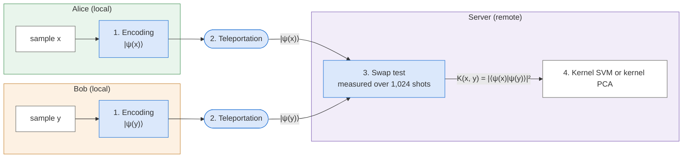
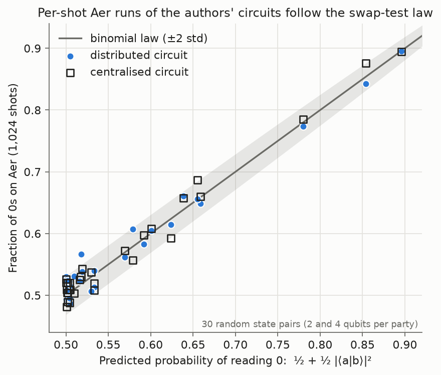
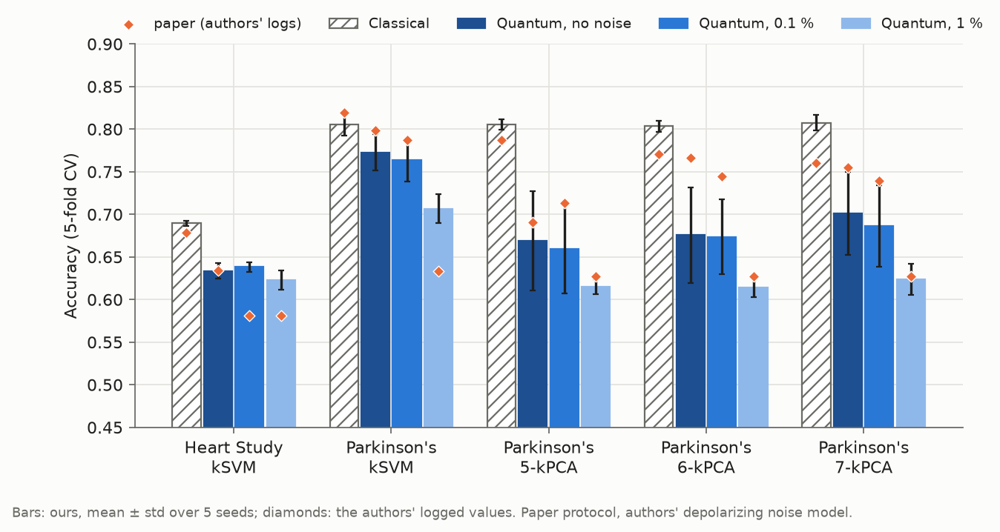
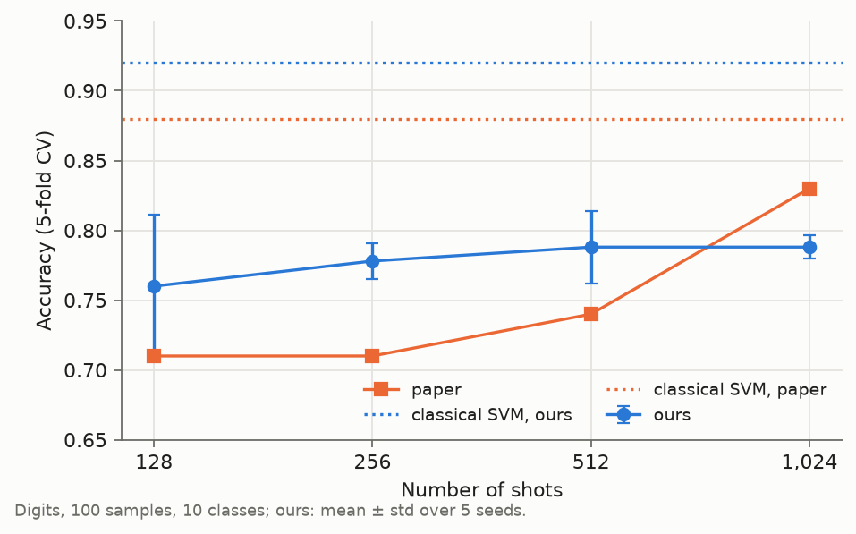
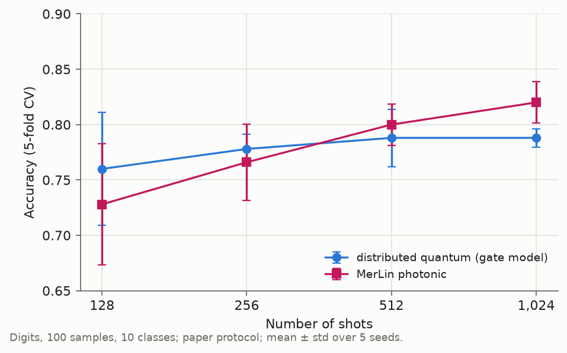

# Distributed and Secure Kernel-Based Quantum Machine Learning - Reproduction

## Reference and Attribution

- Paper: "Distributed and Secure Kernel-Based Quantum Machine Learning", Transactions on Machine Learning Research (2025)
- Authors: Arjhun Swaminathan, Mete Akgün
- OpenReview: https://openreview.net/forum?id=3jdI0aEW3k
- arXiv: https://arxiv.org/abs/2408.10265 (v3, the version read for this reproduction)
- Original repository: https://github.com/mdppml/distributed-secure-kernel-based-QML (commit `aed2cf9` used here), archived on Zenodo as v1.0: https://doi.org/10.5281/zenodo.18743937
- License and attribution notes: the authors' repository is MIT-licensed, like this one. This folder re-implements their pipeline; `lib/protocol.py` ports their circuits gate for gate to Qiskit 2.x.

## Original Paper

Two data holders want to train a kernel method on their joint data without revealing their samples. A kernel SVM never needs the samples themselves, only their pairwise similarities (the kernel matrix). The paper computes each similarity with a quantum protocol:



Blue boxes: quantum states; white boxes: classical data; frames: where each step runs.

The server cannot read the states it receives, since a measurement destroys a state and gives a single bit; the swap test only reveals how similar the two states are. Teleportation uses Bell pairs from a third party, the helper, which never sees the data.

The paper also proposes quantum feature maps for the polynomial, RBF and Laplacian kernels (Sec. 4); its experiments use amplitude encoding only. It evaluates the protocol on three public tabular datasets (accuracy with stratified 5-fold CV, Table 1), with depolarizing noise (Fig. 3), and with the number of shots on Digits images (Fig. 4).

The paper makes three claims:

- **Claim 1: correct kernel.** The distributed protocol computes the same kernel as a centralised swap test (proof in App. A).
- **Claim 2: comparable accuracy.** Distributed quantum accuracy is comparable to centralised quantum and classical accuracy (Table 1).
- **Claim 3: security.** The protocol is secure against semi-honest parties, argued from the no-cloning theorem and destructive measurement: an eavesdropper cannot copy the quantum states without disturbing them, and the server cannot read the states it receives (Sec. 1 and 6.3).

## Reproduction Scope, Claims, and Deviations

Claims 1 and 2 are tested; claim 3 is an argument and is not tested (see Limitations).

- **Claim 1: correct kernel.** Shot-by-shot Aer runs of the authors' circuits follow the swap-test law (see "Simulation setup" below).
- **Claim 2: comparable accuracy.** Table 1 is reproduced on the authors' data files, with the paper's stratified 5-fold CV and 1,024 shots. The paper claims "comparable", not "better", accuracy.

Fig. 3 and 4 are reproduced as side results.

Updates and deviations:

- **Simulation setup.**
  - **Why:** simulating every kernel entry shot by shot, as the authors do on an HPC cluster (Sec. 7), is too costly for us.
  - **What:** each shot reads 0 with a known probability (App. A), so we draw the 1,024 shots directly from that law: same kernel, same shot noise, at a fraction of the cost.
  - **How:** `lib/kernels.py`; shot-by-shot Aer runs of the authors' circuits follow the same law (figure below), which also checks claim 1. Runs on a 10-core macOS CPU (Python 3.14, Qiskit 2.5.2, Aer 0.17.2). Details: `docs/swap_test_kernel.md`.

    

    Each point is one random state pair: the fraction of 0s measured on Aer against the probability the binomial shortcut uses. All points lie on the diagonal, nearly all inside the grey band (±2 standard deviations): Aer follows the law, for both circuits.

- **Protocols.**
  - **Why → What:**
    - reproduce Table 1 in the authors' conditions → `paper`, the authors' evaluation as is;
    - keep test information out of training (oversampled copies in the test folds, component count chosen on the test folds) and tune classical baselines fairly → `corrected`, everything fitted on the training folds only.
  - Both give the same conclusions in balanced accuracy.
  - **How:** `lib/data.py::build_dataset` and `lib/evaluation.py` (`paper_kernel_svm`, `paper_kernel_pca`, `corrected_cv`). Details: `docs/protocols.md`.
- **Additional baselines** (not in the paper).
  - **Why → What:**
    - is the quantum kernel held back by shot noise? → the exact kernel without shot noise;
    - is it held back by the square the swap test imposes? → the exact cosine kernel (the linear kernel the paper names);
    - is it comparable to a fair classical model, as the paper claims? → tuned RBF and polynomial SVMs;
    - does it learn at all? → a majority-class predictor.
  - **How:** `configs/accuracy_<dataset>_reference.json` (paper protocol), `_corrected.json` and `_fair_classical.json` (corrected protocol); results in Table 1 bis and `results/fair_comparison.md`.
- **Seeds.**
  - **Why:** the authors' code sets no seed for the shots or the oversampling.
  - **What:** we repeat each run with seeds 0–4, which change only these two draws; the CV folds and the evaluated subset stay the authors' fixed ones.
  - **How:** `--seed` drives `lib/data.py` (oversampling) and `lib/runner.py` (shots); `utils/run_sweep.py --seeds 0 1 2 3 4`.
- **Photonic adaptation** (not in the paper).
  - **Why:** to check whether the protocol maps onto photonic hardware.
  - **What**, by step of the diagram:
    1. encoding: each sample is amplitude-encoded on photons (2 photons per register of m modes) with the same amplitudes, hence the same kernel; state preparation is assumed ideal;
    2. teleportation: not translated, it has no deterministic linear-optics counterpart;
    3. swap test: run as a MerLin circuit (Hong–Ou–Mandel interference and a parity readout), which follows the same law;
    4. kernel SVM or kernel PCA: unchanged.
  - **How:** `lib/photonic_merlin.py` (MerLin `QuantumLayer`, FOCK space). Details: "Photonic Assessment and MerLin Extension" and `docs/swap_test_kernel.md`.

## Project Layout

```text
distributed_secure_kernels/
|-- notebook.ipynb            walkthrough: claims, live checks and runs, fair comparison, MerLin
|-- cli.json, configs/        paper-specific flags; one JSON config per experiment and variant
|-- lib/
|   |-- runner.py             train_and_evaluate(cfg, run_dir): experiment dispatch
|   |-- data.py, encoding.py  dataset loaders, oversampling, amplitude encoding
|   |-- kernels.py, noise.py  swap-test kernels, shot sampling, exact noisy probabilities
|   |-- protocol.py           the authors' circuits (Qiskit 2.x) and per-shot Aer runs
|   |-- evaluation.py         kernel SVM / kernel PCA under the paper and corrected protocols
|   |-- feature_maps.py, rff_error.py   Theorems 1–6 and Fig. 5
|   `-- photonic_merlin.py    MerLin photonic swap test (adaptation)
|-- utils/                    sweep coordinator, summaries, comparisons, figures
|-- tests/                    pytest suite
|-- docs/                     kernel computation and protocols in detail; dated sweep plans
`-- results/                  curated tables and figures used below
```

## Install and How to Run

```bash
# From the repository root
python -m venv .venv
source .venv/bin/activate
pip install -r papers/distributed_secure_kernels/requirements.txt

python implementation.py --paper distributed_secure_kernels --help

# Smoke run (Wine, paper protocol, seconds)
python implementation.py --paper distributed_secure_kernels --config configs/defaults.json

# One paper experiment for one seed
python implementation.py --paper distributed_secure_kernels --config configs/accuracy_parkinsons_original.json --seed 0

# A full 5-seed sweep (writes outdir/sweep_<id>_<stamp>/ with summary.json)
python papers/distributed_secure_kernels/utils/run_sweep.py --sweep-id table1_original --seeds 0 1 2 3 4 --workers 5 \
    --configs configs/accuracy_wine_original.json configs/accuracy_parkinsons_original.json configs/accuracy_framingham_original.json

# Protocol check (App. A): per-shot Aer runs of the authors' circuits, then the figure (about 3 minutes)
python implementation.py --paper distributed_secure_kernels --config configs/protocol_equivalence_original.json --seed 0
python implementation.py --paper distributed_secure_kernels --config configs/protocol_equivalence_four_qubits.json --seed 0
python papers/distributed_secure_kernels/utils/plot_protocol_check.py
# writes results/protocol_check.png: every point should lie on the diagonal, nearly all inside the grey band
```

Walkthrough: `notebook.ipynb` (run it from this folder) reruns the Wine, Parkinson's and Digits experiments live with five seeds, checks them against the stored sweeps, and loads the longer runs from `results/`. It takes about 2–3 minutes on a laptop CPU.

Each run writes `outdir/run_YYYYMMDD-HHMMSS/` with `run.log`, `run_status.json`, `config_snapshot.json` and `metrics.json`; each sweep writes `outdir/sweep_<id>_<stamp>/` with `sweep.log`, `sweep_status.json` and `summary.{json,md}`. Curated tables and figures are in `results/`. These scripts regenerate them from the sweep and run folders, which are not committed (run the sweeps first):

| Script | Output |
|---|---|
| `utils/compare_with_paper.py` | `results/paper_comparison.{json,md}` |
| `utils/plot_table1.py`, `utils/plot_noise.py`, `utils/plot_shots.py`, `utils/plot_rff_error.py` | the four paper-figure comparisons |
| `utils/diagnose_gaps.py` | `results/gap_diagnostics.json` |
| `utils/compare_merlin.py` | `results/merlin_comparison.{json,md}` |
| `utils/fair_comparison.py`, `utils/plot_fair_comparison.py` | `results/fair_comparison.{json,md,png}` |
| `utils/export_sweep_tables.py` | `results/sweep_results.{md,json}` (full table of every sweep; the JSON keeps the per-seed values the notebook reads) |
| `utils/paper_layout_results.py` | `results/table1.md`, `results/table1_bis.md`, `results/table1_merlin.md`, `results/fig3.png`, `results/fig4.png`, `results/fig4_merlin.png` (paper layout; reads only `results/sweep_results.json`) |
| `utils/plot_protocol_check.py` | `results/protocol_check.png` (per-shot Aer runs vs the swap-test law) |
| `utils/merlin_noise_check.py` | MerLin distinguishability-noise check (printed; see "Photonic Assessment and MerLin Extension") |

## Configuration

`cli.json` is the authoritative list of paper-specific flags: `--protocol`, `--n-splits` and `--cv-random-state`, plus the sweep identity flags that `utils/run_sweep.py` sets. Configs:

| Config | Experiment |
|---|---|
| `accuracy_<dataset>_original.json` | Table 1, the paper's three columns, paper protocol |
| `accuracy_<dataset>_reference.json` | exact squared-overlap and cosine kernels, majority class, paper protocol |
| `accuracy_<dataset>_corrected.json`, `accuracy_<dataset>_classical.json` | corrected protocol; paper columns, and tuned RBF / polynomial SVMs on a first γ grid, 10× off the planned one (the fair comparison uses `accuracy_<dataset>_fair_classical.json`) |
| `noise_<dataset>_original.json` | Fig. 3 |
| `noise_<dataset>_decomposed_initialize.json` | diagnostic: noisy, decomposed state preparation |
| `shots_digits_original.json` | Fig. 4 |
| `rff_error_original.json`, `rff_error_high_dimension.json` | Fig. 5 (d = 10, d = 100,000); `rff_error_reduced.json` is a small version for the tests |
| `feature_map_identities_original.json` | Theorems 1–6 |
| `protocol_equivalence_original.json`, `protocol_equivalence_four_qubits.json` | App. A, per-shot Aer checks |
| `accuracy_<dataset>_merlin.json`, `shots_digits_merlin.json` | MerLin adaptation (photonic swap test), Table 1 and Fig. 4 settings |
| `accuracy_<dataset>_fair_classical.json`, `accuracy_<dataset>_merlin_corrected.json` | fair comparison: tuned RBF / polynomial SVMs (planned grids) and MerLin under the corrected protocol (MerLin: Wine and Parkinson's only) |

## Data

Datasets live under `data/distributed_secure_kernels/` (resolved by `lib/data.py::dataset_dir` from `--data-root`, else the `DATA_DIR` environment variable, else the repository's `data/`), one folder per dataset with a `SHA256SUMS` file. They are not tracked in git.

| Dataset | Folder | Source | Licence |
|---|---|---|---|
| Wine (178 samples, 13 features, 3 classes) | `wine/` | scikit-learn 1.9.1 bundled file (`load_wine`) | UCI, shipped with scikit-learn |
| Digits (1,797 samples, 64 pixels, 10 classes) | `digits/` | scikit-learn 1.9.1 bundled file (`load_digits`) | UCI, shipped with scikit-learn |
| Parkinson's (195 recordings, 22 features) | `parkinsons/` | authors' repository, commit `aed2cf9`; UCI dataset 174 (Little 2007) | CC BY 4.0 |
| Framingham (4,238 patients, 15 features; 14 used) | `framingham/` | authors' repository, commit `aed2cf9`; Kaggle dataset by A. Bhardwaj (2022) | "Unknown" on Kaggle |

To recreate them, clone the authors' repository into `data/distributed_secure_kernels/sources/authors_repo` and copy its two data files and the two scikit-learn files (`wine_data.csv`, `digits.csv.gz` from `sklearn/datasets/data/` of the installed scikit-learn) into the folders above; check with `shasum -a 256 -c SHA256SUMS` in each folder.

Limitations:
- Parkinson's is the UCI file the authors' code reads; the paper cites a different Parkinson's dataset (Sakar et al. 2019).
- The Framingham file is the authors' copy. Its size differs from the file listed on Kaggle (195,955 vs 191,803 bytes); the contents were not compared because the Kaggle download needs a login.
- Fig. 5 uses synthetic standard-normal data generated at run time, as in the authors' script (the paper only says "simulated datasets").

## Results Obtained and Comparison with the Paper

Stratified 5-fold CV; kSVM: kernel SVM, kPCA: kernel PCA followed by a linear SVM. Paper: one run, ± fold std. Ours: mean ± std over seeds 0–4. The cell-by-cell differences and the matching rule are in `results/paper_comparison.md`.

### Table 1 (paper protocol, accuracy)

| Dataset | Method | | Centralised classical | Centralised quantum | Distributed quantum |
|---|---|---|---:|---:|---:|
| Wine | kSVM | paper | 0.986 ± 0.017 | 0.880 | 0.887 ± 0.026 |
| | | ours | 0.986 ± 0.000 | 0.907 ± 0.019 | 0.896 ± 0.009 |
| Parkinson's | kSVM | paper | 0.820 ± 0.064 | 0.787 | 0.798 ± 0.080 |
| | | ours | 0.805 ± 0.013 | 0.772 ± 0.021 | 0.756 ± 0.035 |
|  | kPCA | paper | 0.787 ± 0.072 | 0.745 | 0.766 ± 0.074 |
| | | ours | 0.812 ± 0.005 | 0.703 ± 0.045 | 0.700 ± 0.047 |
| Framingham | kSVM | paper | 0.679 ± 0.011 | 0.631 | 0.634 ± 0.014 |
| | | ours | 0.689 ± 0.003 | 0.634 ± 0.009 | 0.639 ± 0.010 |
|  | kPCA | paper | 0.679 ± 0.009 | 0.625 | 0.642 ± 0.009 |
| | | ours | 0.682 ± 0.004 | 0.625 ± 0.000 | 0.625 ± 0.000 |

12 of 15 cells fall within the paper's fold std; distributed and centralised quantum differ only by shot noise.

### Fig. 3 (paper protocol, noise)



Noise lowers accuracy in both, but less in ours: at 1 % the Parkinson's kernel SVM falls to 0.707, against 0.633 in the authors' logs. The size of the drop depends on whether state preparation is noisy, which the paper does not state; noise is not one of our messages.

### Fig. 4 (paper protocol, shots)



Our accuracy rises little with shots (0.760 at 128 shots, 0.788 at 1,024), less than the paper's (0.71 to 0.83); our steps are smaller than the seed spread at 128 shots.

### Table 1 bis (corrected protocol, balanced accuracy)

Classical columns: linear and RBF SVMs, tuned by inner cross-validation.

| Dataset | Method | Centralised classical | Centralised quantum | Distributed quantum | RBF SVM |
|---|---|---:|---:|---:|---:|
| Wine | kSVM | 0.983 ± 0.000 | 0.896 ± 0.014 | 0.895 ± 0.010 | 0.983 ± 0.000 |
| Parkinson's | kSVM | 0.751 ± 0.016 | 0.622 ± 0.038 | 0.623 ± 0.034 | 0.913 ± 0.008 |
|  | kPCA | 0.745 ± 0.012 | 0.582 ± 0.021 | 0.591 ± 0.039 | 0.698 ± 0.026 |
| Framingham | kSVM | 0.629 ± 0.001 | 0.501 ± 0.001 | 0.501 ± 0.001 | 0.512 ± 0.004 |
|  | kPCA | 0.547 ± 0.006 | 0.500 ± 0.000 | 0.500 ± 0.000 | 0.511 ± 0.004 |

Without the leaks of the authors' protocol, a classical SVM is higher beyond 2 σ of the seed spread on every dataset, and on Framingham the quantum kernel only predicts the majority class (balanced accuracy 0.50). Even with the authors' protocol, the linear SVM is higher beyond 2 σ in 4 of the 5 Table 1 cells. Full comparison: `results/fair_comparison.md`.

## Photonic Assessment and MerLin Extension

This is an adaptation, not the paper's method: only the encoding and the swap test are translated (see "Photonic adaptation" above). It is simulated with MerLin on CPU, with ideal photon-number-resolving detectors (FOCK space; threshold detectors cannot read the parity), ideal state preparation (not deterministic with linear optics), no loss and no postselection. In every run, the photonic probability matches the swap-test law to within 2.6 × 10⁻⁸. Paper protocol, accuracy, mean ± std over seeds 0–4.

### Table 1 settings

4 photons on 12 modes (Wine, Framingham) or 16 modes (Parkinson's); 1,024 shots per kernel entry.

| Dataset | Method | Centralised quantum | Distributed quantum | MerLin photonic |
|---|---|---:|---:|---:|
| Wine | kSVM | 0.907 ± 0.019 | 0.896 ± 0.009 | 0.909 ± 0.013 |
| Parkinson's | kSVM | 0.772 ± 0.021 | 0.756 ± 0.035 | 0.764 ± 0.019 |
|  | kPCA | 0.703 ± 0.045 | 0.700 ± 0.047 | 0.706 ± 0.045 |
| Framingham | kSVM | 0.634 ± 0.009 | 0.639 ± 0.010 | 0.632 ± 0.011 |
|  | kPCA | 0.625 ± 0.000 | 0.625 ± 0.000 | 0.625 ± 0.000 |

The photonic kernel matches the distributed gate-model kernel within 2 σ of the seed spread in every cell.

### Fig. 4 settings

Digits: 4 photons on 24 modes; 128 to 1,024 shots per kernel entry.



The two agree within 2 σ at 128, 256 and 512 shots. At 1,024 shots MerLin is higher by 0.032, just above the 2 σ tolerance (0.029); the two kernels follow the same law, so this comes from independent shot draws.

### Fig. 3 settings

Not run. The photonic counterpart of gate noise is photon distinguishability, but MerLin's model of it fails a basic check on our states: two identical registers should give P(even) ≈ 1 with nearly perfect photons (indistinguishability 0.9999), and MerLin gives 0.77, as if the superposition were lost (`utils/merlin_noise_check.py`). With this model, a noisy photonic run would not be meaningful.

## Limitations

- **Proof of concept only:** simulation on one machine, amplitude encoding only (the proposed feature maps are never used for learning), and a tuned classical SVM beats the quantum kernel (Table 1 bis), although it tunes hyperparameters that the quantum kernel does not have.
- **Security is argued, not tested:** all parties run as one simulated circuit on one standardised dataset, and we only check that the clients' messages are uniform. Our inference: the server receives about 1,024 × m copies of each encoded state, which could let it estimate the data.
- **Side results:** the authors' Qiskit version (which decides where the Fig. 3 noise acts) and Digits evaluation script are unknown, their Framingham noisy values stay unexplained, and the cost of teleportation under noise is not measured.

## Tests

46 tests: data loading and oversampling, kernels and shot statistics, exact noisy probabilities and per-shot Aer agreement, protocol circuits, feature maps, both evaluation protocols, CLI wiring, the photonic swap test and the fair-baseline grids.

```bash
cd papers/distributed_secure_kernels
pytest -q
```

## Citation and License

The authors ask to cite the paper and the code as follows.

Paper:

```bibtex
@article{
swaminathan2025distributed,
title={Distributed and Secure Kernel-Based Quantum Machine Learning},
author={Arjhun Swaminathan and Mete Akg{\"u}n},
journal={Transactions on Machine Learning Research},
issn={2835-8856},
year={2025},
url={https://openreview.net/forum?id=3jdI0aEW3k},
note={}
}
```

Code:

```bibtex
@software{Swaminathan2025QML,
  author    = {Swaminathan, A. and Akg{\"u}n, M.},
  title     = {Distributed and Secure Kernel-Based Quantum Machine Learning - code},
  version = {v1.0},
  year      = {2025},
  publisher = {Zenodo},
  doi       = {10.5281/zenodo.18743937},
  url       = {https://doi.org/10.5281/zenodo.18743937}
}
```

Dataset licences are listed under "Data".
